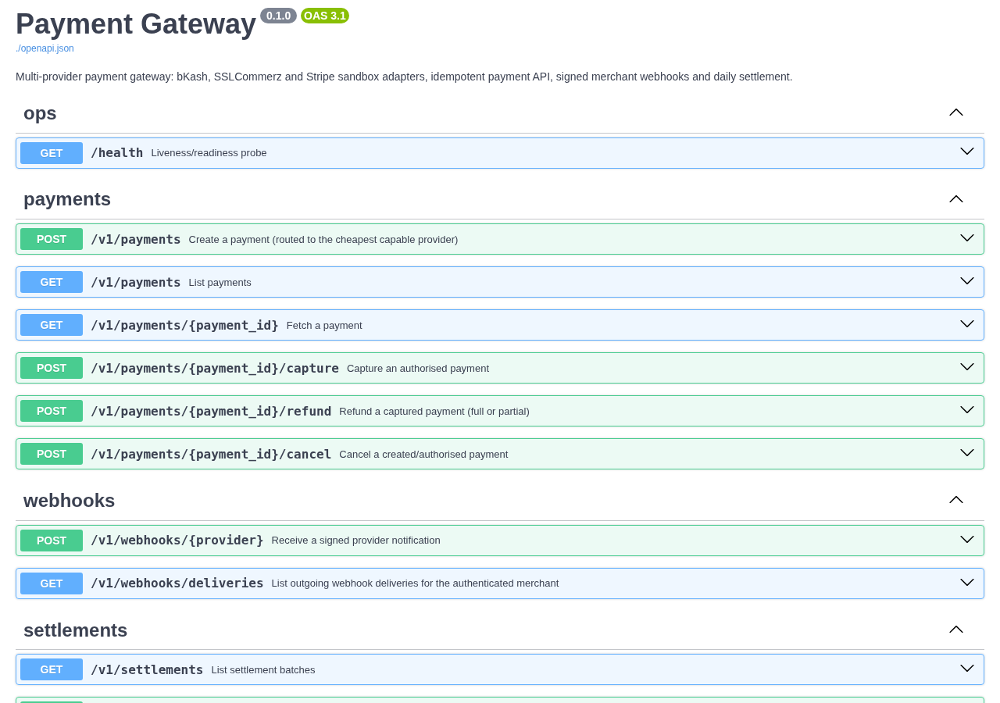
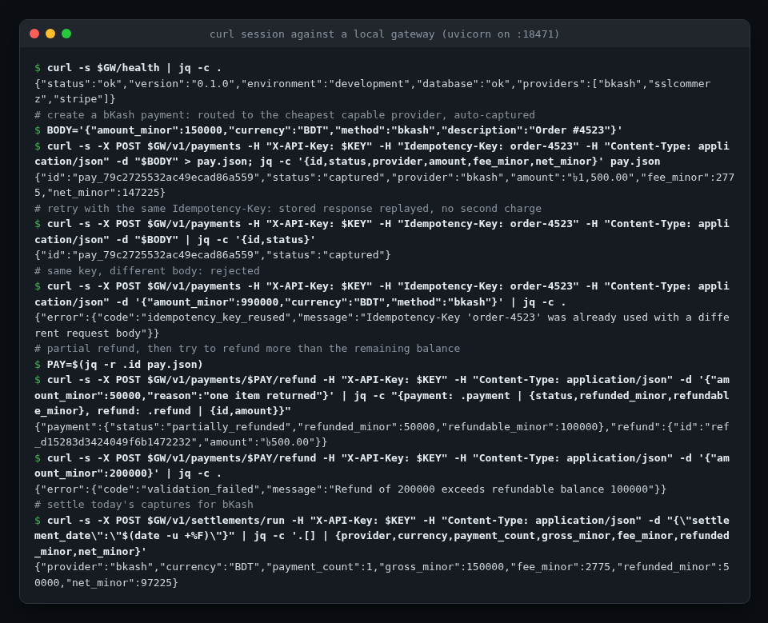

<!-- topics: fastapi,python,payment-gateway,fintech,bkash,sslcommerz,stripe,idempotency,webhooks,sqlalchemy,docker -->
# FastAPI Payment Gateway

A multi-provider payment gateway service: one API in front of bKash, SSLCommerz and Stripe, with idempotent requests, a strict payment state machine, signed merchant webhooks, fee-aware routing and daily settlement with reconciliation.

[](https://github.com/AkibUllah/fastapi-payment-gateway/actions/workflows/ci.yml)
[](https://github.com/AkibUllah/fastapi-payment-gateway/actions/workflows/codeql.yml)
[](https://github.com/AkibUllah/fastapi-payment-gateway/releases)


## Try it live

| | |
|---|---|
| API reference | https://akibullah.github.io/fastapi-payment-gateway/ — Swagger UI built from the exported OpenAPI document (static; no backend behind it) |
| Run in your browser | [](https://codespaces.new/AkibUllah/fastapi-payment-gateway?quickstart=1) — starts API + PostgreSQL with `docker compose`, creates a demo merchant (`Dhaka Mart`) and writes its API key to `.demo-merchant.txt`; open forwarded port 8000 at `/docs` and use that key as `X-API-Key`. |
| One-click deploy | [](https://render.com/deploy?repo=https://github.com/AkibUllah/fastapi-payment-gateway) — `render.yaml` provisions the web service and a free PostgreSQL; create a merchant afterwards with `python -m app.cli create-merchant` in the Render shell. |
| Local | `docker compose up` (see Quick Start) |

## Screenshots



Live API reference on GitHub Pages: payments, provider webhooks and settlement endpoints.



A real curl session against a local instance: bKash payment with fee routing, idempotent replay, key reuse rejected, partial refund, over-refund blocked, settlement run.

## Why this exists

Every e-commerce or POS product I have shipped in Bangladesh ended up integrating bKash and SSLCommerz (and Stripe for card payments abroad), and every one of them re-solved the same problems: retried requests creating duplicate charges, refunds that drifted out of sync with the provider, webhooks that could not be trusted, and a month-end spent matching provider reports to the ledger by hand. This service is the shared layer those products should have had from day one. Money is handled in integer minor units end to end, every state change goes through one transition table, and settlement produces a file finance can actually reconcile. The provider adapters are sandbox implementations behind a single protocol, so a real integration is a drop-in adapter rather than a rewrite.

## Features

- Provider adapter pattern: `BkashAdapter`, `SSLCommerzAdapter`, `StripeAdapter` (sandbox) and a `MockProvider` for tests, all behind one `PaymentProvider` protocol
- Payment lifecycle state machine (`CREATED → AUTHORIZED → CAPTURED → PARTIALLY_REFUNDED/REFUNDED`, plus `FAILED`/`CANCELLED`); illegal transitions are rejected with HTTP 409 and never persisted
- `Idempotency-Key` header on create/capture/refund: the key is reserved before the provider is called, so a concurrent duplicate gets `409` with `Retry-After` instead of a second charge; stored responses are replayed byte-for-byte, reuse with a different body is rejected, and a crashed request frees its key after a short lease
- Merchant API keys stored as SHA-256 hashes with a lookup prefix; per-merchant data isolation
- Outgoing merchant webhooks signed with HMAC-SHA256 (`X-Gateway-Signature: t=…,v1=…`), delivery log queryable via the API
- Durable webhook retries: a failed delivery is rescheduled in the database (1m, 5m, 30m, 2h, 12h with jitter) and sent by a worker that can run as many copies as you like, so a merchant outage or a gateway restart loses nothing and no row is sent by two workers at once; `POST /v1/webhooks/deliveries/{id}/retry` redelivers on demand
- Inbound provider webhook verification (bare HMAC for bKash/SSLCommerz, timestamped Stripe-style signature with replay window) with idempotent event application
- Fee-aware routing: cheapest provider for a currency/method pair, overridable per request; fees computed in basis points with half-up integer rounding, no floats anywhere near money
- Full and partial refunds with refundable-balance enforcement; partial captures re-quote the fee
- Daily settlement batches per provider and currency, CSV export, reconciliation that diffs the provider report against the ledger (mismatches, missing, unexpected) and a `PAID` close-out
- Health endpoint, request-id middleware, structured error envelope, OpenAPI docs at `/docs`

## Architecture

```mermaid
flowchart LR
    M[Merchant backend] -- "X-API-Key + Idempotency-Key" --> API[FastAPI /v1]
    API --> IDEM[Idempotency store]
    API --> SVC[PaymentService]
    SVC --> SM[State machine]
    SVC --> RT[Router + fee table]
    RT --> BK[bKash adapter]
    RT --> SZ[SSLCommerz adapter]
    RT --> ST[Stripe adapter]
    SVC --> DB[(SQLite / PostgreSQL)]
    SVC --> OUT[Webhook outbox]
    OUT -- "HMAC-signed POST" --> M
    WRK[Webhook worker x N] -- "claim due rows" --> DB
    WRK -- "retries" --> M
    BK & SZ & ST -. "signed notifications" .-> WH[/v1/webhooks/{provider}]
    WH --> SVC
    SET[SettlementService] --> DB
    SET -- "CSV / reconcile" --> FIN[Finance]
```

Key decisions:

- **One mutation path.** Every status change goes through `PaymentService._transition`, which consults the transition table, stamps timestamps, appends a `PaymentEvent` and queues the merchant webhook. There is no second way to flip a status.
- **Idempotency is transactional and race-safe.** A request first inserts an `in_progress` reservation for its key and commits it, so the unique constraint on (merchant, key) picks exactly one winner even when duplicates arrive in the same millisecond; the others get `409 idempotency_key_in_progress` with `Retry-After` and never reach a provider. The stored response and the business change are then committed together, so a crash between them cannot leave a charge without a replayable receipt. If the holder dies, its reservation's lease (`IDEMPOTENCY_LOCK_SECONDS`) expires and the next retry takes the key over.
- **Webhooks are an outbox with a durable retry queue.** Deliveries are rows written in the same transaction as the state change, and the delivery log is the source of truth, not the HTTP call. A background task makes the fast in-request attempts after commit; whatever fails moves to `retrying` with a jittered `next_attempt_at`, and only turns `failed` once the whole schedule has run. Every row is due from the moment it is committed, so a crash before the first send loses nothing.
- **Workers lease rows, they don't hold locks.** A worker claims one row at a time with `SELECT ... FOR UPDATE SKIP LOCKED` in a short transaction and stamps a lease and a fencing token on it, then sends with no transaction open, so a slow merchant never pins a database connection. If a worker dies mid-send, the row returns when `WEBHOOK_LEASE_SECONDS` expires; if one merely overruns, its token no longer matches and it cannot start another attempt or overwrite the new owner. That makes delivery at-least-once: a crash between the merchant's 2xx and the database write resends the event, so receivers should deduplicate on `X-Gateway-Delivery`. Retries can also arrive out of order, so use the payload's status rather than arrival order.
- **Integers for money.** Amounts are minor units (`150000` = ৳1,500.00); fee rules are basis points plus a fixed component with half-up rounding done in `Decimal`, never `float`.
- **Settlement is a snapshot.** A batch locks in gross, fee and refunded amounts per payment at run time; payments carry their `settlement_id` so a re-run never double-settles.

## Tech Stack

| Layer | Choice |
| --- | --- |
| API | FastAPI, Pydantic v2, Uvicorn |
| Persistence | SQLAlchemy 2.0 (typed `Mapped` models); SQLite for dev/tests, PostgreSQL 16 via docker compose (psycopg 3) |
| HTTP client | httpx (outgoing webhooks, injectable transport for tests) |
| Config | pydantic-settings, `.env` |
| Tooling | pytest, ruff, Makefile, GitHub Actions (3.10/3.11 matrix, PostgreSQL concurrency job, docker build) |
| Runtime | Python 3.10+, multi-stage Dockerfile, non-root user, healthcheck |

## Quick Start

### Docker Compose (API, webhook worker + PostgreSQL)

```bash
git clone https://github.com/AkibUllah/fastapi-payment-gateway.git
cd fastapi-payment-gateway
cp .env.example .env
docker compose up --build -d
docker compose exec api python -m app.cli create-merchant "Dhaka Mart" --webhook-url https://example.com/hooks
# -> prints api_key: pk_test_... (shown once)
curl -s localhost:8000/health
```

### Local (SQLite)

```bash
make install            # python3 -m venv .venv && pip install -e ".[dev]"
make merchant NAME="Dhaka Mart"
make dev                # uvicorn on http://127.0.0.1:8000, docs at /docs
API_KEY=pk_test_... ./scripts/demo.sh
```

Create and refund a payment:

```bash
curl -s -X POST localhost:8000/v1/payments \
  -H "X-API-Key: $API_KEY" -H "Idempotency-Key: order-4521" \
  -H "Content-Type: application/json" \
  -d '{"amount_minor":150000,"currency":"BDT","method":"bkash","description":"Order #4521"}'

curl -s -X POST localhost:8000/v1/payments/pay_.../refund \
  -H "X-API-Key: $API_KEY" -H "Content-Type: application/json" \
  -d '{"amount_minor":50000,"reason":"one item returned"}'
```

Sandbox tip: `"metadata": {"sandbox_outcome": "fail"}` makes the adapter decline, which exercises the `failed` path.

## API

All `/v1` routes except `/v1/webhooks/{provider}` require `X-API-Key`. Errors use `{"error": {"code", "message"}}`.

| Method | Path | Purpose |
| --- | --- | --- |
| `GET` | `/health` | Liveness: DB check, version, configured providers |
| `POST` | `/v1/payments` | Create a payment; routed to the cheapest capable provider (`provider` overrides). Supports `Idempotency-Key` |
| `GET` | `/v1/payments` | List the merchant's payments (`status`, `limit`, `offset`) |
| `GET` | `/v1/payments/{id}` | Payment with event history and refunds |
| `POST` | `/v1/payments/{id}/capture` | Capture an authorised payment (optional partial `amount_minor`) |
| `POST` | `/v1/payments/{id}/refund` | Full or partial refund; enforces refundable balance |
| `POST` | `/v1/payments/{id}/cancel` | Cancel a created/authorised payment |
| `POST` | `/v1/webhooks/{provider}` | Inbound provider notification; signature verified, applied idempotently |
| `GET` | `/v1/webhooks/deliveries` | Outgoing webhook delivery log (`payment_id`, `status`: `pending`, `retrying`, `delivered`, `failed`) |
| `POST` | `/v1/webhooks/deliveries/{id}/retry` | Redeliver now. `202` when queued, `200` with nothing sent if already delivered, `404` for another merchant's delivery. Safe to repeat |
| `GET` | `/v1/settlements` | List batches (`provider`, `settlement_date`, `status`); `X-Total-Count` header |
| `POST` | `/v1/settlements/run` | Generate batches for a date (default: yesterday UTC) |
| `GET` | `/v1/settlements/{id}` | Batch with lines |
| `GET` | `/v1/settlements/{id}/export.csv` | CSV with per-payment lines and a TOTAL row |
| `POST` | `/v1/settlements/{id}/reconcile` | Diff against provider report rows (or the adapter's report if omitted) |
| `POST` | `/v1/settlements/{id}/mark-paid` | Close a reconciled batch |

Outgoing webhook headers: `X-Gateway-Event`, `X-Gateway-Delivery`, `X-Gateway-Signature: t=<unix>,v1=<hmac-sha256 hex of "<t>.<body>">`. Verify with `app.core.security.verify_signature_header(secret, body, header)`.

### Webhook worker

Failed deliveries wait in the database until a worker sends them, so run one alongside the API. `docker compose up` starts it as `webhook-worker`.

```bash
python -m app.cli dispatch-webhooks          # one pass, for cron
python -m app.cli dispatch-webhooks --loop   # long-running worker; stops cleanly on SIGTERM
docker compose up -d --scale webhook-worker=3
```

| Setting | Default | Meaning |
| --- | --- | --- |
| `WEBHOOK_MAX_ATTEMPTS` | `3` | Attempts right after the request, before the schedule takes over |
| `WEBHOOK_RETRY_SCHEDULE` | `60,300,1800,7200,43200` | Seconds between scheduled retries; empty disables them |
| `WEBHOOK_RETRY_JITTER` | `0.1` | Each step varies by this fraction |
| `WEBHOOK_LEASE_SECONDS` | `60` | How long a worker owns a row; at least 4 x `WEBHOOK_TIMEOUT_SECONDS` |
| `WEBHOOK_DISPATCH_POLL_SECONDS` | `5` | Worker sleep when the queue is empty |
| `WEBHOOK_DISPATCH_BATCH_SIZE` | `50` | Rows per pass |

A worker sends one row at a time, so an endpoint that times out costs it `WEBHOOK_TIMEOUT_SECONDS` per row; add workers if many merchants can be down at once. The one-click Render blueprint stays on the free plan and has no worker: see the note at the top of `render.yaml`.

Routing table (sandbox fees, basis points): bKash direct 185 (BDT/bkash), SSLCommerz 250 min ৳2 (BDT/card, bkash, nagad, rocket, netbanking), Stripe 290 + 30¢ (USD/EUR/GBP card).

## Project Structure

```
app/
├── main.py              # app factory, middleware, error envelope
├── config.py            # pydantic-settings
├── database.py          # engine/session factory (SQLite StaticPool for tests)
├── models.py            # SQLAlchemy 2.0 models
├── schemas.py           # Pydantic request/response models
├── cli.py               # create-merchant, run-settlement, purge-idempotency, dispatch-webhooks
├── core/
│   ├── money.py         # minor units, FeeRule, half-up rounding
│   ├── state_machine.py # PaymentStatus + transition table
│   ├── routing.py       # PaymentRouter + fee table
│   ├── security.py      # API keys, HMAC signatures
│   ├── backoff.py       # webhook retry schedule + jitter
│   └── idempotency.py   # fingerprint + store
├── providers/
│   ├── base.py          # PaymentProvider protocol, result types
│   ├── sandbox.py       # shared in-memory sandbox behaviour
│   ├── bkash.py · sslcommerz.py · stripe.py · mock.py
│   └── registry.py
├── services/
│   ├── payments.py      # PaymentService (single mutation path)
│   ├── webhooks.py      # outbox, signed sender, dispatcher
│   ├── webhook_queue.py # claims, leases and fencing on delivery rows
│   └── settlements.py   # batches, CSV, reconciliation
└── api/                 # routers: payments, webhooks, settlements, health
tests/                   # 155 tests, SQLite in-memory, httpx MockTransport
```

## Testing

```bash
make test        # pytest
make cov         # with coverage
make lint        # ruff check + format check
```

Covered: every legal and illegal state transition; fee rounding (half-up, floors, caps) and decimal conversions; routing choice, overrides and no-route errors; API key hashing; signature creation, tampering, stale timestamps and malformed headers; idempotent create/refund replay, scoped keys and body-mismatch rejection; key reservations (duplicate in flight → 409 with no provider call, lease expiry takeover, losing the insert race, release after a failed request, and 8 truly concurrent requests on PostgreSQL reserving the key exactly once); the full API flow (auto/manual capture, partial capture, cancel, partial then full refund, over-refund, sandbox decline, merchant isolation); outgoing webhook signing and in-request retries; the retry schedule with jitter, final failure only after the last step, a crashed worker's row coming back after its lease, stale workers fenced out, a full restart, and the merchant-scoped idempotent manual retry; 4 workers on PostgreSQL sending 40 rows exactly once with no lock held during the HTTP call; inbound bKash/SSLCommerz/Stripe notifications including idempotent re-delivery and terminal-state guards; settlement netting, CSV export, clean and discrepant reconciliation, and the CLI.

Tests need no Postgres or network: the app runs on an in-memory SQLite engine and merchant webhooks go to an `httpx.MockTransport`. The 5 concurrency tests that need real row locks are skipped unless `TEST_DATABASE_URL` points at a PostgreSQL database, which CI does (their schema is dropped, so use a throwaway database).

## Roadmap

- [ ] Alembic migrations (schema is currently created with `create_all`) (#1)
- [ ] Real HTTP adapters for bKash tokenized checkout and SSLCommerz behind the same protocol, with recorded fixtures (#3)
- [ ] Settlement adjustments for refunds that happen after a batch is generated (#4)
- [ ] Per-merchant fee contracts loaded from configuration instead of the static table (#5)

## License

MIT — see [LICENSE](LICENSE).
